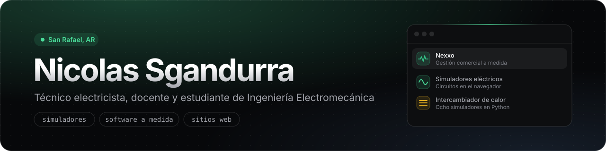

Hola, soy Nico. Doy clases de Circuitos Eléctricos y estudio Ingeniería Electromecánica en la UTN San Rafael. Cuando un tema de clase cuesta explicarlo, le hago un simulador, y también programo software y sitios web a medida.

[Portfolio](https://nicosgandurra.github.io/) · [LinkedIn](https://www.linkedin.com/in/nicosgandurra) · nico.sgandurra@gmail.com

### Proyectos

<table>
  <tr>
    <td width="50%" valign="top">
      
      <h4><a href="https://nicosgandurra.github.io/proyectos/nexxo.html">Nexxo</a></h4>
      Sistema de gestión para un comercio de motos y repuestos: ventas, stock, caja y encargos. Python, FastAPI, PostgreSQL y React. 
      Repositorio privado · <a href="https://nicosgandurra.github.io/proyectos/nexxo.html">ver la presentación</a>
    </td>
    <td width="50%" valign="top">
      
      <h4><a href="https://github.com/NicoSgandurra/SimCircuitosElectricos">Simuladores de circuitos eléctricos</a></h4>
      Factor de potencia, neutro flotante, sistemas trifásicos, teoremas de redes y caída de tensión, desde el navegador. 
      <a href="https://nicosgandurra.github.io/SimCircuitosElectricos/">Probar</a> · <a href="https://github.com/NicoSgandurra/SimCircuitosElectricos">código</a>
    </td>
  </tr>
  <tr>
    <td width="50%" valign="top">
      
      <h4><a href="https://nicosgandurra.github.io/proyectos/atuel-motos-web.html">Sitio web de Atuel Motos</a></h4>
      Catálogo de motos, cascos e indumentaria con simulador de cuotas. Astro, Supabase y Cloudflare. 
      <a href="https://atuelmotos.com.ar/">atuelmotos.com.ar</a> · <a href="https://nicosgandurra.github.io/proyectos/atuel-motos-web.html">presentación</a>
    </td>
    <td width="50%" valign="top">
      
      <h4><a href="https://nicosgandurra.github.io/proyectos/intercambiador-de-calor.html">Intercambiador de calor de casco y tubos</a></h4>
      Ocho simuladores en Python para diseñar y revisar un intercambiador metanol-agua, con Monte Carlo y análisis económico. 
      Repositorio privado · <a href="https://nicosgandurra.github.io/proyectos/intercambiador-de-calor.html">ver la presentación</a>
    </td>
  </tr>
  <tr>
    <td width="50%" valign="top">
      
      <h4><a href="https://nicosgandurra.github.io/proyectos/cuackdernos.html">Cuackdernos</a></h4>
      Configurador para diseñar un cuaderno de discos, verlo en vivo y encargarlo por WhatsApp. 
      <a href="https://cuackdernos.web.app/">cuackdernos.web.app</a> · <a href="https://nicosgandurra.github.io/proyectos/cuackdernos.html">presentación</a>
    </td>
    <td width="50%" valign="top">
      
      <h4><a href="https://nicosgandurra.github.io/proyectos/mibilletera.html">MiBilletera</a></h4>
      Finanzas personales: movimientos, tarjetas en cuotas, gastos fijos y ahorro, sincronizado con Firebase. 
      Repositorio privado · <a href="https://nicosgandurra.github.io/proyectos/mibilletera.html">ver la presentación</a>
    </td>
  </tr>
  <tr>
    <td width="50%" valign="top">
      
      <h4><a href="https://github.com/NicoSgandurra/Oswald">Triángulo de Oswald</a></h4>
      Análisis de una combustión a partir de los gases de escape. Hecho con Pablo Rubio. 
      <a href="https://nicosgandurra.github.io/SimCircuitosElectricos/M%C3%A1quinas%20T%C3%A9rmicas/oswald.html">Probar</a> · <a href="https://github.com/NicoSgandurra/Oswald">código</a>
    </td>
    <td width="50%" valign="top">
      
      <h4><a href="https://nicosgandurra.github.io/proyectos/capacidad-dinamica-de-lineas.html">Capacidad dinámica de una línea aérea</a></h4>
      Cuánta corriente admite una línea según el clima de cada hora, con 31 años de datos y un modelo térmico en Python. 
      Repositorio privado · <a href="https://nicosgandurra.github.io/proyectos/capacidad-dinamica-de-lineas.html">ver la presentación</a>
    </td>
  </tr>
</table>

También en GitHub: [PCScanner](https://github.com/NicoSgandurra/PCScanner-TecNito), un relevamiento de hardware en PowerShell, y el [control de un motor paso a paso](https://github.com/NicoSgandurra/StepByStepMotorControlWithArduinoUNO) con Arduino.

### Herramientas

- Ingeniería: Mathcad, AutoCAD, Autodesk Inventor y Excel
- Programación: Python, JavaScript, TypeScript, React, FastAPI y PostgreSQL
- Web: Astro, Tailwind CSS, Firebase, Supabase y Cloudflare
- Otras: Git, GitHub, Arduino y PowerShell
